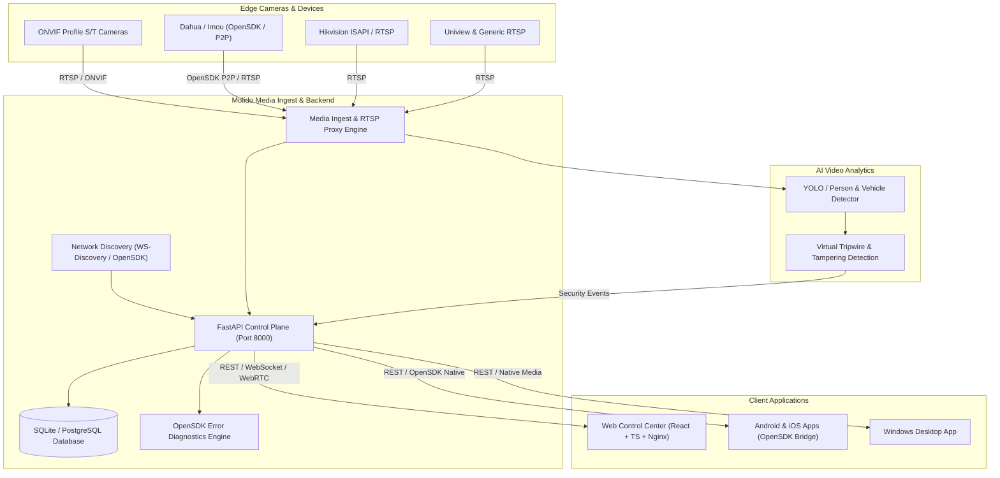

# Molido CCTV AI - Platform Architecture

## 1. Overview
Molido CCTV AI is a high-performance, multi-brand video surveillance management platform (VMS) engineered to support up to 100 cameras on initial baseline deployments across Web, Windows desktop, Android, and iOS clients.

## 2. Platform Core Components

### 2.1 Backend (`backend/`)
- **FastAPI Core**: Async REST API handling authentication (JWT), camera inventory, operational metrics, PTZ telemetry, and security events.
- **Async Database Layer**: SQLAlchemy 2.0 with async SQLite (`aiosqlite`) default, fully ready for PostgreSQL (`asyncpg`).
- **OpenSDK Error Resolution Engine**: Diagnostic catalog mapping vendor codes (e.g. RTSP 401, 503, DHHTTP 503001, DEC_KEY_ERROR) to root cause analysis and automated remediation strategies.

### 2.2 Web Control Center (`frontend/`)
- Built with React 19, TypeScript, and high-performance Vanilla CSS.
- Multi-matrix view (1x1, 2x2, 3x3, 4x4) with real-time video simulation and overlay telemetry.
- Bilingual support: English (en, LTR) and Persian (fa, RTL) with instant language switching.
- PTZ mechanical joystick controller and integrated OpenSDK error resolver.

### 2.3 Mobile & OpenSDK Ingest (`mobile/`)
- Native Kotlin / Swift bindings for Dahua/Imou OpenSDK V3.8.0.
- P2P hole-punching session configuration (`OpenSDK_LoginManager`).
- Bluetooth Low Energy (BLE) smart door access module.

### 2.4 Hybrid Storage Model
- Local SSD cache for low-latency playback buffering and real-time motion snapshots.
- Object storage (S3 / MinIO compatible) for long-term historical recordings with retention policies.
